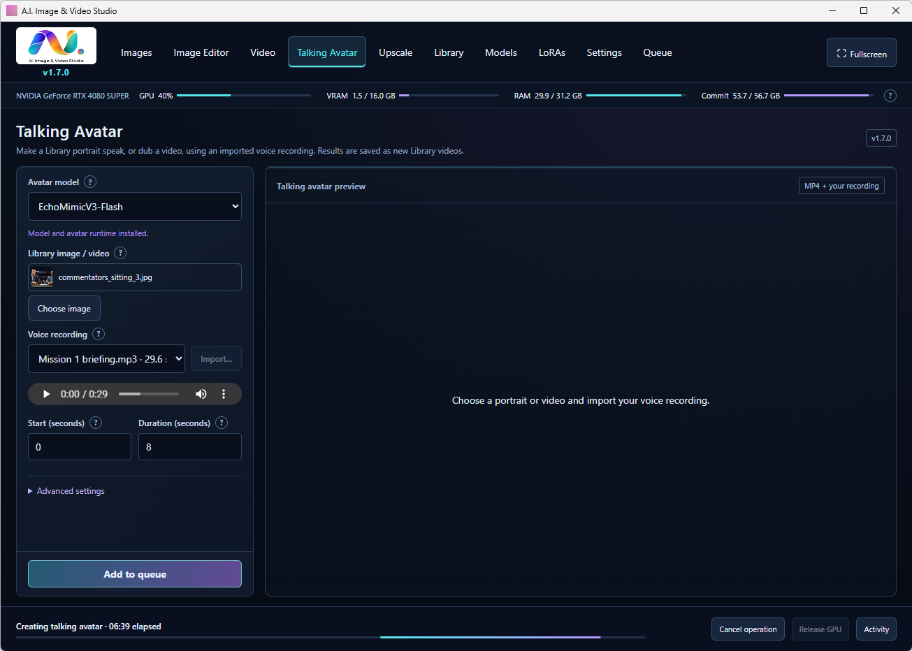

# A.I. Image & Video Studio

a Windows desktop app for n00bs that uses the most popular A.I. models to bring you:
| --- |
| Local text-to-image generation
| Local image editing
| Local Text-to-video generation
| Local Image-to-video generation
| Local Talking avatar & Lipsync generation
| One-click downloading and installation of the top models and easy installation and managing of LoRaS. 
| Some models can produce NSFW images or videos.

Check [Gumroad](https://backgroundpeople.gumroad.com/l/AI-image-video-studio) to see some examples and download the program.

Includes image generation and editing models, text/image-to-video models, talking avatars and lip sync. See the [complete model list and VRAM guidance](#models) below, including SDXL, FLUX, Qwen, MOSS/Kromoss, Wan, LTX-2 and MiniMax H3.

Need more models? Or don't understand how to use LoRaS? You can download the source code of this program or copy the link and feed it to Chatgpt or Claude and ask to include your github or huggingface link.

Download the Windows installer from [GitHub Releases](https://github.com/JungleJimJim/AI-Image-Video-Studio/releases/latest) The repository contains the application source and small setup assets; model weights download separately.
If you'd like to support this project, you can make a donation through [Gumroad](https://backgroundpeople.gumroad.com/l/AI-image-video-studio). 

## Canvas workspace in 1.15.0

A Photoshop-inspired charcoal workspace puts the preview in the center and generation/edit properties on the right. The left tool rail and top tabs keep all existing tools available. A bottom **Recent media** strip opens Library items and filters images/videos. **Focus** expands the preview, **Properties width** adjusts the dock on larger windows, and **Reset workspace** restores the layout. Width and filmstrip preferences save locally. Canvas retains editable layers, project saving and export.

## Installation

Easiest way: Download the Windows installer from [GitHub Releases](https://github.com/JungleJimJim/AI-Image-Video-Studio/releases/latest).

Run **AIImageVideoStudio-Setup.exe**. The default application location is **C:\Program Files\AI Image & Video Studio**. Setup lets you choose another location, a separate writable folder for models/data, and desktop and Start menu shortcuts. Existing studio folders can be upgraded while preserving settings and media. Finish or cancel any current render before upgrading.

The installer downloads the portable Python/PyTorch/ComfyUI runtime and NSFW Wan 1.3B E14 base model. Optional packs can be selected in setup or installed later from **Models**. Downloads resume after cancellation and use pinned revisions and SHA-256 checks. Shared encoder/VAE files are downloaded only once. Model weights are not bundled into the small installer.

## Models

The current app offers **32 model packs** (including the original Wan 1.3B), plus optional components. Model weights download separately. Choose **Models → All models / 8 GB VRAM / 16 GB VRAM** to filter the catalog; the 16 GB view includes the lighter 8 GB candidates.

**VRAM figures are estimates or recommendations for the exact packs used by Studio, not guaranteed minimums.** No Studio generation benchmark on an 8 GB GPU has been run. Use Low VRAM mode and start with small outputs; CPU offloading is slower and needs system RAM. Resolution, video length, reference images and LoRAs affect memory use. Download size is separate from VRAM. Unverified fits remain under All models. [VRAM sources and validation](docs/RELEASE-1.14.3.md).

### Image generation and editing

| Model | Tools | Starting settings | VRAM guidance |
| --- | --- | --- | --- |
| Z-Image-Turbo | Text to image | 8 steps, CFG 1 | 16 GB recommended (BF16) |
| FLUX.2 Klein 4B | Images and instruction editing; up to three references | 4 steps, CFG 1 | 8 GB estimated (FP8/offloading); 16 GB for larger images/references |
| FLUX 3 Image Klein · INT8 | Images and instruction editing; up to ten references | 16 steps, CFG 1 | 16 GB suggested with CPU/RAM offloading; 8 GB unverified |
| Qwen-Image-2512 | Images and typography | 40 steps, CFG 4 | 16 GB suggested with CPU/RAM offloading; 8 GB unverified |
| Juggernaut XL v9 | Images, redraw and masked editing | 28 steps, CFG 6 | 8 GB estimated; Low VRAM mode, one image at a time |
| Illustrious XL 2.0 | Images, redraw and masked editing | 28 steps, CFG 5 | 8 GB estimated; Low VRAM mode, one image at a time |
| DreamShaper XL Turbo 2.1 | Images, redraw and masked editing | 8 steps, CFG 2 | 8 GB estimated; Low VRAM mode, one image at a time |
| RealVisXL v5 | Images, redraw and masked editing | 50 steps, CFG 6 | 8 GB estimated; Low VRAM mode, one image at a time |
| CyberRealistic XL v1.1 | Images, redraw and masked editing | 30 steps, CFG 6 | 8 GB estimated; Low VRAM mode, one image at a time |
| Krea 2 Turbo | Eight-step text to image | 8 steps, CFG 1 | 16 GB suggested with CPU/RAM offloading; 8 GB unverified |
| Qwen Image Edit 2511 | Instruction editing; up to three images | 40 steps, CFG 3 | 16 GB suggested with CPU/RAM offloading; 8 GB unverified |
| Qwen Image 2.1 · Viggle Turbo v0.3 | Six-step image generation/editing; up to three images | 6 steps, CFG 1 | 16 GB suggested with CPU/RAM offloading; 8 GB unverified |
| BFS · Qwen 2.1 Head Swap v1.1 | Image face/head replacement | 40 steps, CFG 1 | 16 GB suggested with CPU/RAM offloading; 8 GB unverified |
| Qwen-Image 2.1 · Detail Enhancer | Optional image detail enhancement | 25 steps, CFG 1 | 16 GB suggested with CPU/RAM offloading; 8 GB unverified |
| MOSS-Image SFT · INT8 | Text, tags, spatial layouts, masked editing and optional color/depth control | 50 steps, CFG 3 | 16 GB suggested with CPU/RAM offloading; 8 GB unverified |
| MOSS-Image SFT · BF16 | Text, tags, spatial layouts, masked editing and optional color/depth control | 50 steps, CFG 3 | Minimum unverified; 16 GB needs heavy offloading; prefer INT8 |
| MOSS-Image Base · INT8 | Text, tags, spatial layouts, masked editing and optional color/depth control | 50 steps, CFG 3 | 16 GB suggested with CPU/RAM offloading; 8 GB unverified |
| MOSS-Image Base · BF16 | Text, tags, spatial layouts, masked editing and optional color/depth control | 50 steps, CFG 3 | Minimum unverified; 16 GB needs heavy offloading; prefer INT8 |
| Kromoss · INT8 | Text, tags, spatial layouts, masked editing and optional color/depth control | 50 steps, CFG 3 | 16 GB suggested with CPU/RAM offloading; 8 GB unverified |
| Kromoss · BF16 | Text, tags, spatial layouts, masked editing and optional color/depth control | 50 steps, CFG 3 | Minimum unverified; 16 GB needs heavy offloading; prefer INT8 |

### Video generation

| Model | Tools | Starting settings | VRAM guidance |
| --- | --- | --- | --- |
| NSFW Wan 1.3B · E14 | Text to video | 30 steps, CFG 6 | 8 GB conditional; Low VRAM mode, small/short clips. 16 GB recommended |
| Wan 2.2 · Image to Video | Text or image to video | 30 steps, CFG 6 | 16 GB suggested with CPU/RAM offloading; 8 GB unverified |
| LTX-2 · Audio & Video | Text or image to video; optional audio | Fixed 8-step recipe, CFG 1 | 16 GB suggested with CPU/RAM offloading; 8 GB unverified |
| MiniMax H3 · Turbo (Pepe104) | Text / first-and-last-image to video with audio | 6 steps, CFG 1 | Minimum unverified; 16 GB experimental; substantial RAM/paging |
| MiniMax H3 · Ref2VA VSA | Reference image to video; optional audio and experimental VSA | 4 steps, CFG 1 | 24 GB author requirement; smaller cards unverified |
| MiniMax H3 · Singularity V2 INT8 | Reference image to video with audio; dense attention | 4 steps, CFG 1 | Minimum unverified; 16 GB experimental; substantial RAM/paging |
| WAMU · Wan 2.2 I2V Lightning 14B | Two-stage image-to-video Lightning merge; silent video | 4 steps, CFG 1 | Minimum unverified; 16 GB experimental; substantial RAM/paging |

### Talking avatars and lip sync

| Model | Tools | Starting settings | VRAM guidance |
| --- | --- | --- | --- |
| EchoMimicV3-Flash | Portrait + recording to talking avatar | 8 steps | 16 GB suggested with CPU/RAM offloading; 8 GB unverified |
| SoulX-FlashHead · Lite & Pro | Portrait + recording; Lite and Pro variants | Use the model defaults | Minimum unverified; Lite/Pro differ; upstream speed tests use 24 GB GPUs |
| LongCat-Video-Avatar 1.5 · Q4 | Portrait + recording; Q4 base and distillation adapter | Use the model defaults | Minimum unverified; 16 GB experimental; substantial RAM/paging |
| InfiniteTalk · Q4 | Portrait animation or video dubbing with a recording | Use the model defaults | Minimum unverified; 16 GB experimental; substantial RAM/paging |
| MuseTalk 1.5 | Portrait/video lip sync with a recording | Use the model defaults | 8 GB estimated (FP16); longer videos also need system RAM |

### Optional components and separate services

- **MOSS text encoders:** W4A8, INT8 and BF16; **MOSS full VAE**; and **MOSS fast LoRAs & color/depth control**. These five component packs work with a MOSS/Kromoss base model and have no independent VRAM minimum. The selected precision and workflow determine memory use.
- **FaceFusion 3.9.1:** separate video faceswap tool; install/repair it from Faceswap or Models. Its memory use depends on the selected processors and video settings.
- **NVIDIA RTX video enhancement:** optional RTX VSR processing; requires a compatible NVIDIA RTX GPU and driver.
- **Fish Speech S2-Pro / Drama 3:** Voice connects to a separately configured local Linux/WSL server; Studio does not install these as native Windows model packs. S2-Pro supports CPU and recommends 24 GB GPU memory. Drama 3 FP8 requires 48 GB; its INT4 weights alone are about 20.8 GB and do not fit a 16 GB GPU.

Models shows each pack's installation state and download/storage estimate. Shared encoders and VAEs download only once. Model licenses and access requirements vary; review the terms linked in the app before installing.

Windows 10/11 x64, an NVIDIA RTX GPU and a compatible current NVIDIA driver are required for generation. Large Qwen/LTX models use disk-backed loading and RAM offloading on 16 GB cards; sufficient Windows committed memory is still required. Workflow validation does not establish performance or guarantee that every resolution/duration fits your hardware. The app does not change Windows paging settings.

## FLUX 3 Image Klein

FLUX 3 is a separate full image model, distinct from the existing FLUX.2 Klein. In **Models**, choose **FLUX 3 Image Klein · INT8**. Its official gated weights require signing in to [the Hugging Face model page](https://huggingface.co/black-forest-labs/flux-3-image-klein-comfy), reviewing the access conditions and obtaining access. Enter a read token for that account in Settings, then return to Models to install the selected pack. Tokens are used only for the current download and are not saved. The model pack is approximately **11.0 GB** (10.3 GiB); its separate engine adds about 14 MB of downloads.

The fast distilled checkpoint uses Euler/simple sampling, 16 starting steps and fixed CFG 1; negative prompts are ignored. It is available in Images and Image Editor, and works with the existing queue, library, video handoff and optional image enhancement. The editor accepts the starting image plus nine extra references. Refer to them as `<ref_image_0>` through `<ref_image_9>` and describe the complete desired edited result. Painted edits preserve the resized original outside the mask. Studio output dimensions remain 256–1536 pixels in multiples of 64; higher native model resolutions and a graphical bounding-box editor are not exposed by this integration.

A pinned ComfyUI 0.41.0 engine is downloaded to its own folder only for this model. Its `comfy-aimdo` dependency is installed separately, with no global package upgrades. Other models retain the existing engine. FLUX 3's VAE is stored under a distinct filename because the upstream file differs from the existing FLUX.2 VAE. Its LoRA library is also separate; use adapters explicitly compatible with distilled FLUX 3 Image Klein 5.6B.

The optional prompt upsampler and slower Base checkpoint are not installed by this pack. FLUX 3 weights retain the **FLUX Kommunity License**, separate from the application's MIT license. Actual model inference and memory fit on this machine have not been tested; the new engine's CPU probe and native graph checks do not load weights.

## Seeds and library details

**New seed for each job** is enabled by default in Images, Image Editor, Video and image enhancement. Adding a new job prepares a fresh seed for the next job, so queued variations have independent seeds. Disable it to keep a fixed seed for comparisons. Queued jobs, retries and saved results retain their exact seed. **Reuse settings** selects a fixed seed for reproduction.

Opening a Library item shows its model, seed, prompts, dimensions, processing time, LoRAs and saved parameters. Enhanced or enlarged copies show their processing status and source history, including the original model and seed. Missing legacy metadata is marked as not recorded.

## Images and Image Editor

**Images** generates a PNG and saves its seed/options/workflow beside it. **Send to editor** or **Send to video** selects the image in that tool; it does not begin another render.

**Image Editor** supports:

- Instruction edits with FLUX.2 Klein, FLUX 3 Image Klein and Qwen Image Edit. The starting image is image 1; add up to two extra reference images and mention image 2/image 3 in the instruction.
- SDXL redraw with Juggernaut, Illustrious or DreamShaper. Describe the full desired image and adjust redraw strength.
- Painted masks, with brush size, paint/erase, undo and clear. SDXL uses inpaint denoising. Instruction models edit the full image and composite only the painted region onto the resized original. Saved edits preserve a mask copy beside the result.
- Crop/resize using original pixel coordinates, center-square/full-image shortcuts and an aspect-ratio lock. CPU processing saves a separate PNG without loading an AI model.

Import or drag in PNG, JPEG or WebP up to 25 MB and 25 megapixels. Imports are saved as PNG copies, honor camera orientation and leave the original intact. AI output dimensions are multiples of 64 between 256 and 1536 pixels. Crop/resize exports support 64–4096 pixels.

## Library and video

**Library** combines generated videos, generated/edited images, imports, crops and extracted frames. Search, media filters and pagination include older records. Square thumbnails are cached CPU previews; original files keep their full aspect ratio and dimensions. Click an item to preview it, save a copy, or reuse available generation settings. Images can be sent to the editor or video tool.

For videos, **Use frame** lets you play/scrub the MP4, enter a timestamp and save a frame directly to the editor or image-to-video tool. This creates a PNG library entry and keeps the MP4. New crop/edit/frame entries retain their source ID.

**NSFW Wan 1.3B E14** uses the requested fine-tuned checkpoint and is text-only. Wan 2.2 and LTX-2 animate starting images. LTX-2 exports optional audio and uses its published distilled sigma schedule. Video frames are capped at 481: Wan uses 4n+1, LTX uses 8n+1. Exact duration is shown as frames/FPS. Long clips need much more memory/time and may lose consistency; begin with short clips and smaller dimensions.

## Layout, settings and LoRAs

The desktop window supports maximize and **Fullscreen / F11**; Escape exits fullscreen. Main action buttons remain visible, while advanced controls and library contents scroll inside their own panels. The resource bar shows GPU, VRAM, RAM and committed memory across the computer.

**Settings** selects output storage and opens image/video/log folders in Explorer. MP4s use the chosen output folder; AI PNGs use its Images subfolder. Imports and CPU edits use the studio data folder. Changing the output folder does not move older media.

**LoRAs** has its own tab, with all twelve model targets. Import local `.safetensors` files or download a Hugging Face file link, then enable adapters, set strengths and click **Save selection**. Images, Image Editor and Video have a **Manage LoRAs** shortcut and show how many saved adapters are enabled for their selected model. Each model remembers its own selection; switching the LoRA target also preserves unsaved drafts.

The tab links to [CivitAI](https://civitai.com/models?types=LORA) and a model-specific [Hugging Face search](https://huggingface.co/models?other=lora). Links open in your regular browser from the native app. Download a matching file from CivitAI and import it locally; direct downloads in the app accept Hugging Face file links. Access or license requirements remain those of the source site and adapter author.

Juggernaut, DreamShaper and Illustrious share an SDXL file library but retain separate enabled selections. Other model families use separate libraries; existing Wan 1.3B files and selections are preserved. SDXL and Wan 1.3B expose separate model and text encoder strengths. Other families apply model-only adapters. Up to eight adapters can be enabled per model, with strengths from -2 to 2.

Choose an adapter matching the **exact base model** described in the tab: Wan 2.2 TI2V **5B**, FLUX.2 Klein **4B distilled**, Qwen-Image **2512**, Qwen Image Edit **2511**, Qwen-Image **2.1**, distilled **FLUX 3 Image Klein 5.6B**, and LTX-2 **19B distilled** are distinct targets. The app validates file format and library assignment, not the trained weights' semantic compatibility. Check the author's trigger words, version and sampling recipe; specialized control or acceleration adapters may need a different workflow. No weights are bundled. Installing the optional Qwen 2.1 enhancer explicitly downloads its required detail LoRA; other adapters are installed by the user.

## Queue and model removal

Every AI generator now adds a job to **Queue**. Jobs run one at a time across images, edits, videos and enhancement passes. Add more while a job runs. Higher priorities (0–10) run first; arrows reorder jobs with equal priorities. A running job is never interrupted by priority changes.

Pause lets the current job finish. Cancel stops a waiting job or requests interruption of the running job. **Edit** pauses the queue and opens a waiting job's full options in its tool; save changes and resume when ready. Seeds, source images, masks, LoRAs, enhancement options and output folders are captured per job. Retry makes a new copy. **Continue after failed jobs** is enabled by default, keeping errors in history while the remaining jobs run. Disable it to pause on failure. Unfinished jobs reopen paused; interrupted jobs require review and retry. Clearing queue history keeps library media.

**Models → Uninstall** previews the exact downloaded weights and disk space. Shared files needed by another installed model, runtime software, LoRAs, settings and library media are kept. Finish or cancel jobs referencing the model first. Removed weights can be downloaded again; uninstalling the original Wan model does not disable installed optional models.

## Optional enhancement

**Upscale** takes an existing library image or video and saves a separate enhanced entry. The library preview has an **Upscale / enhance** button. Alternatively, enable **Enhance after generation** in Images, Image Editor or Video. Configure its options on Upscale; each queued job captures a copy. A failed or cancelled enhancement leaves the original available.

The requested [Elusarca Qwen 2.1 Detail Enhancer](https://civitai.com/models/2956730/elusarcas-qwen-21-detail-enhancer) is a LoRA for Qwen-Image 2.1. Install its pack in Models: approximately **17.4 GB** of separate downloads, including the author's hash-matched adapter from Hugging Face. It uses instruction-conditioned generative enhancement, so fine details may change. The result is capped at roughly four megapixels and 4096 pixels per axis. Qwen 2.1 has its own **Qwen Research License**; check the terms linked in Models. Its LoRA target is distinct from Qwen 2512 and Qwen Edit 2511. The built-in detail adapter plus up to seven additional compatible adapters can be used.

[RTX video enhancement](https://github.com/tritant/ComfyUI_NVIDIA_RTX_VSR_Long_Video) uses the pinned upstream frame pipeline in an isolated worker. Install its optional component in Models (about **467 MB** of SDK/FFmpeg downloads). This preserves the existing PyTorch stack and leaves global ComfyUI custom nodes disabled. It requires an RTX GPU and a supported NVIDIA driver; NVIDIA's SDK lists Windows driver 570.65 or newer. Quality, 1–4× scale, denoise/deblur, segment size and encoder are configurable. Audio is retained where supported. It increases resolution, not duration or frame rate. H.264 NVENC outputs are limited to 4096 pixels per axis; HEVC/CPU encoder support depends on the FFmpeg build and output size. The NVIDIA SDK retains its vendor license.

New enhancement workflows have been validated without loading weights. Actual Qwen 2.1/RTX VSR inference and quality have not been tested in this release.

## Validation and source

See **outputs/VALIDATION.md** for exact checks and limitations. AI generation tests require explicit user permission. Source packages exclude downloaded weights, personal media, profiles and credentials.

Build with Python plus **requirements-build.txt**, then run **python build.py** and **python package_source.py**. Exact file revisions/sizes/hashes are in **assets/manifest.json**, **assets/packs.json**, **assets/enhancers.json** and **assets/engines.json**. See **outputs/THIRD-PARTY.txt** for upstream terms. The Windows installer is unsigned.

For a Windows source build:

```powershell
py -m venv .venv
.\.venv\Scripts\Activate.ps1
python -m pip install -r requirements-build.txt
python -m unittest discover -s tests
python build.py
python package_source.py
```

The build downloads the pinned Microsoft WebView2 SDK if it is absent and compiles the native host using the Windows .NET Framework compiler. The automated tests do not generate AI images or videos.

The app's original source code uses the [MIT license](LICENSE). Third-party components and model weights retain their upstream licenses; see [third-party notices](outputs/THIRD-PARTY.txt).


## Updates in v1.6.0


Open **Settings → Check for updates** to check the public GitHub repository for a newer stable Windows release. If available, the app shows its version, download size and release notes and asks whether to install it. **Later** keeps the current app. **Install update** downloads and verifies GitHub's SHA-256 checksum before closing the studio, replacing application files and reopening its desktop window.

Settings, downloaded models, LoRAs, library media and queued jobs remain in their existing data folder. Installation is blocked during active processing; checking is allowed. The queue pauses for installation and reopens paused until you choose Resume queue. Updates never start inference, reinstall models or change the selected data folder. Program Files installations can require a Windows administrator prompt. Temporary application-copy failures restore the previous binaries. A failed download can be retried from Settings; its partial file is resumable.

The installed version appears directly below the logo. **About**, at the bottom right of Settings on wide windows, credits Codex in collaboration with Jungle Jim and links to the requested 3D models, Blender add-ons, software, VFX and source code. Models sits between Library and LoRAs.

